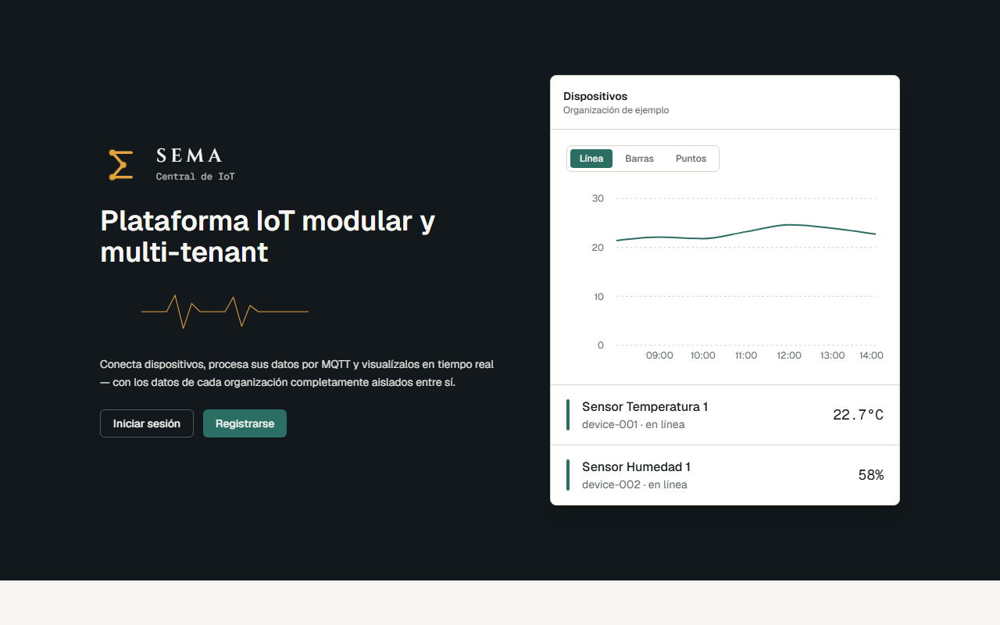
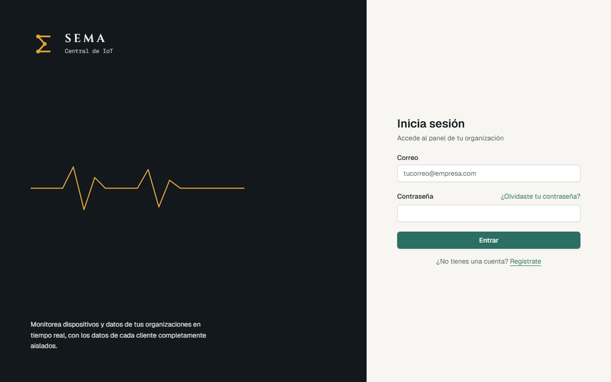
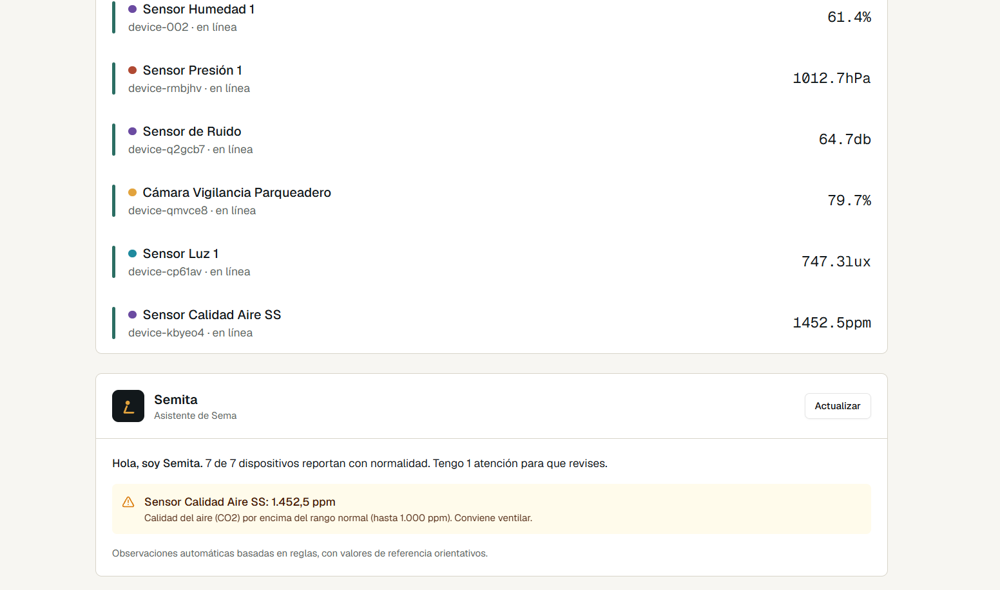
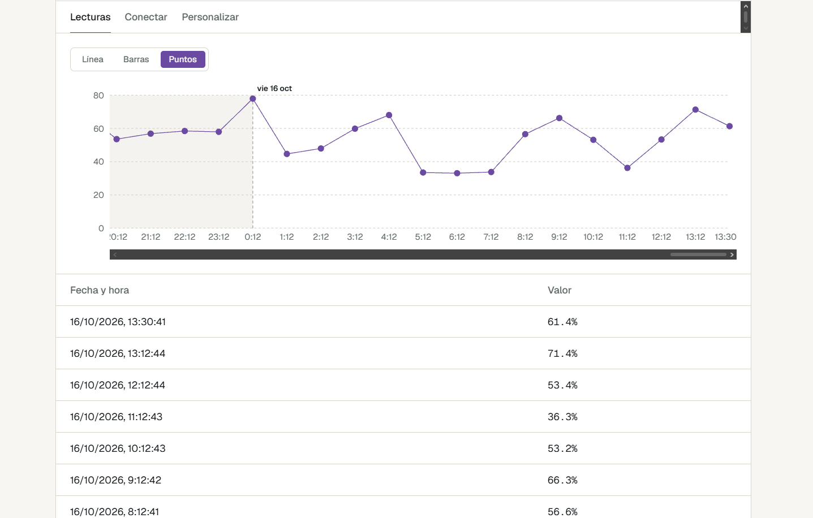
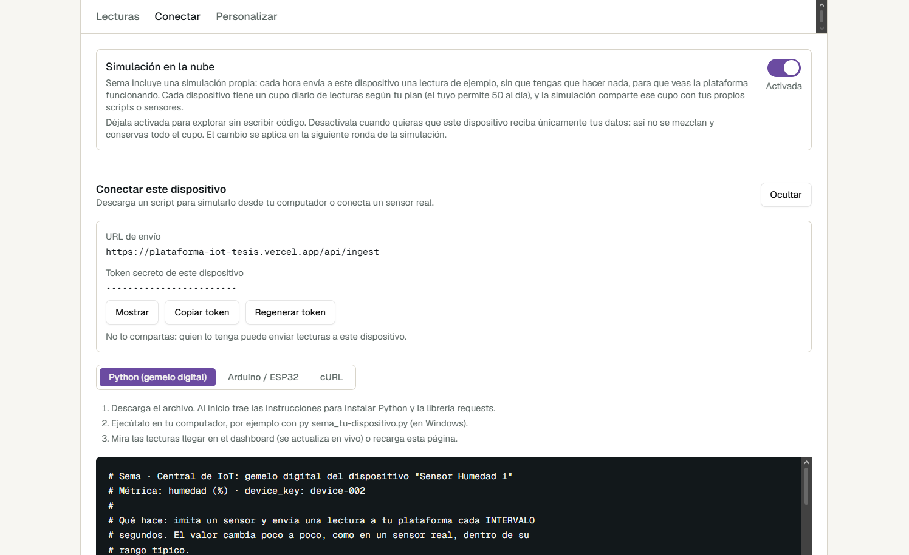

# Sema · Central de IoT

**Plataforma IoT modular y multi-tenant** — Proyecto de Grado, Ingeniería de Sistemas, Universidad Autónoma de Bucaramanga (UNAB).

**Autor:** Sergio Alejandro Amaya Corzo
**Director:** Mg. Javier Pinzón Castellanos
**Periodo:** 2026-2
**Aplicación desplegada:** https://plataforma-iot-tesis.vercel.app

<p>
  
  
</p>

---

## 📋 Descripción

El Internet de las Cosas (IoT) ha impulsado la creación de plataformas capaces de conectar dispositivos, procesar datos en tiempo real y visualizar información mediante dashboards. Sin embargo, soluciones comerciales como AWS IoT Core, Azure IoT Hub o ThingsBoard suelen implicar costos, dependencia del proveedor (*vendor lock-in*) y limitaciones de personalización: barreras importantes para entornos académicos y de experimentación.

Sema es un **prototipo funcional de plataforma IoT modular y multi-tenant**. Permite gestionar varias organizaciones de forma aislada, recibir los datos de sus dispositivos por MQTT o por HTTP, y visualizarlos en tiempo real. Está pensada como una base de aprendizaje y experimentación sobre arquitecturas de software distribuidas: cada usuario puede descargar un script para simular su propio sensor, o conectar uno real.

El nombre viene del griego *σῆμα* (*sema*, "señal"); la **Σ** del logo es un pulso hecho de nodos.

## 🎯 Objetivos

**Objetivo general.** Diseñar un prototipo de plataforma IoT modular y multi-tenant que gestione dispositivos y visualice datos en tiempo real, facilitando la experimentación y el aprendizaje de arquitecturas IoT en entornos académicos.

**Objetivos específicos**

1. Analizar plataformas IoT existentes, identificando patrones arquitectónicos, funcionalidades y limitaciones en gestión de dispositivos, multi-tenancy, visualización de datos y escalabilidad.
2. Diseñar la arquitectura de la plataforma bajo un enfoque modular y multi-tenant, integrando la comunicación de dispositivos, el procesamiento de datos y la visualización.
3. Implementar un prototipo funcional que utilice un broker MQTT para la recepción y procesamiento de datos de dispositivos.
4. Evaluar el funcionamiento del prototipo frente a los indicadores técnicos y operativos definidos, en un entorno controlado.

## ✨ Qué puede hacer

| Área | Funcionalidad |
|---|---|
| **Multi-tenant** | Cada registro crea su propia organización. El aislamiento entre organizaciones lo impone la base de datos (Row Level Security), no el código de la aplicación |
| **Dispositivos** | Alta, renombrado y baja desde la interfaz, con un catálogo de 10 métricas (temperatura, humedad, presión, nivel, luminosidad, ruido, CO2, viento, voltaje y batería), cada una con su unidad |
| **Tiempo real** | El dashboard muestra el último valor y el estado de cada dispositivo y se actualiza sin recargar |
| **Gráficas** | Línea, barras o puntos; scroll horizontal con eje Y fijo, separador de días y tooltip con la fecha completa; el tipo elegido se recuerda |
| **Planes** | Básico (3 dispositivos, 10 lecturas diarias por dispositivo), Medio (5 y 25) y Pro (10 y 50). Los límites los imponen *triggers* de PostgreSQL, así que aplican también a las lecturas que llegan por MQTT |
| **Conectar dispositivos** | Por **MQTT** (a través de HiveMQ Cloud y el bridge) o por **HTTP** con un token por dispositivo (`POST /api/ingest`) |
| **Aprendizaje** | En cada dispositivo se descarga un script ya configurado: gemelo digital en **Python**, sketch para **ESP32** o ejemplo con **cURL** |
| **Simulación en la nube** | Un interruptor por dispositivo activa lecturas simuladas periódicas, para ver la plataforma funcionando sin escribir código |
| **Personalización** | Por organización: nombre, color de acento y formato de hora. Por dispositivo: nombre, ubicación, color y gráfica favorita |
| **Semita** | Asistente basado en **reglas** (no es inteligencia artificial): resume el estado de los dispositivos y avisa de valores fuera de rango, cambios bruscos, tendencias, falta de señal y cupo diario |

## 🖼️ Así se ve

**Dashboard con Semita.** Cada dispositivo muestra su color, su último valor y su estado; debajo, Semita resume la situación y avisa de lo que sale de lo normal.



**Detalle de un dispositivo.** Gráfica con scroll lateral, eje Y fijo y separador de días; el historial de lecturas queda debajo.



**Conectar un dispositivo.** Interruptor de la simulación en la nube, URL y token, y scripts listos para descargar en Python, ESP32 y cURL. El color de acento (aquí violeta) es el que eligió la organización.



## 🏗️ Arquitectura

```
        Dispositivos, scripts y simuladores
              │                       │
              │ MQTT                  │ HTTP + token del dispositivo
              ▼                       ▼
        HiveMQ Cloud            /api/ingest  (Next.js en Vercel)
              │ MQTT                  │
              ▼                       │
   Bridge en Python (AWS EC2)         │
              │ inserta               │ inserta
              └───────────┬───────────┘
                          ▼
       Supabase: PostgreSQL + Auth + Row Level Security + Realtime
                          │ consulta y eventos en tiempo real
                          ▼
              Dashboard web (Next.js en Vercel)
```

Hay **dos vías de entrada** de datos: MQTT (el camino principal, con el bridge) y HTTP (`/api/ingest`, pensada para scripts de estudiantes y sensores reales que no quieren manejar credenciales del broker). Las dos terminan en la misma tabla y pasan por los mismos límites del plan.

| Componente | Dónde corre | Cómo se mantiene |
|---|---|---|
| Aplicación web (Next.js) y `/api/ingest` | Vercel | Despliegue automático en cada `push` |
| Base de datos, autenticación y Realtime | Supabase | Servicio administrado; el esquema se respalda en `supabase/schema.sql` |
| Broker MQTT | HiveMQ Cloud | Servicio administrado, conexión con TLS |
| Bridge (`bridge/bridge.py`) | Instancia EC2 de AWS | Servicio `systemd` con reinicio automático |
| Publicador automático (`simulator/auto_publisher.py`) | La misma instancia EC2 | Servicio `systemd` con reinicio automático |

**Principios de diseño**

- **Modular:** ingesta, persistencia y visualización son independientes y reemplazables.
- **Multi-tenant:** ningún cliente puede ver datos de otro, aunque conozca los identificadores.
- **Tiempo real:** las lecturas se reflejan en el dashboard sin recargar.

## 🔐 Seguridad y multi-tenancy

- **Row Level Security** en todas las tablas: cada política filtra por `get_my_tenant_id()`, y la aplicación no contiene lógica de tenant.
- **Permisos por columna:** los usuarios solo pueden modificar el nombre, el color, la ubicación y la gráfica favorita de sus dispositivos. El `api_token`, el `device_key` y la simulación en la nube solo se cambian mediante funciones de la base de datos que comprueban que el dispositivo es de su organización.
- **Token por dispositivo** para `/api/ingest`: identifica un único dispositivo, se puede regenerar y nunca es la credencial del broker. Un token inválido o ausente responde siempre con el mismo mensaje.
- **Llaves solo en el servidor:** la llave `service_role` de Supabase nunca llega al navegador (sin prefijo `NEXT_PUBLIC_`). Los archivos `.env` no se versionan.

## 🛠️ Stack tecnológico

| Capa | Tecnología |
|---|---|
| Frontend | Next.js 16 (App Router), React, TypeScript, Tailwind CSS, shadcn/ui, Recharts |
| Base de datos, autenticación y tiempo real | Supabase: PostgreSQL, Auth, Row Level Security y Realtime |
| Mensajería | MQTT sobre TLS — HiveMQ Cloud |
| Bridge y simuladores | Python 3 (`paho-mqtt`, `supabase`, `python-dotenv`) |
| Despliegue | Vercel (frontend) y AWS EC2 con `systemd` (bridge y publicador) |
| Control de versiones | Git y GitHub |

## 📁 Estructura del repositorio

```
/frontend    → Aplicación Next.js: dashboards, /api/ingest, Semita y personalización
/bridge      → Servicio que se suscribe al broker MQTT y guarda las lecturas en Supabase
/simulator   → Scripts que simulan dispositivos y publican por MQTT
/supabase    → schema.sql: respaldo del esquema (tablas, funciones, triggers y políticas RLS)
/assets      → Imágenes de este README
```

## 🚀 Cómo correrlo en tu computador

**Requisitos:** Node.js 20 o superior, Python 3.8 o superior, y cuentas gratuitas en [Supabase](https://supabase.com) y [HiveMQ Cloud](https://www.hivemq.com/mqtt-cloud-broker/).

### 1. Base de datos (Supabase)

1. Crea un proyecto en Supabase.
2. Abre el **SQL Editor**, pega el contenido de [`supabase/schema.sql`](supabase/schema.sql) y ejecútalo.
3. En **Authentication → URL Configuration**, agrega `http://localhost:3000` (y la URL de tu despliegue) como sitio y como URL de redirección permitida.

> ⚠️ `schema.sql` es un respaldo que se mantiene a mano; todavía no se ha probado reconstruyendo un proyecto desde cero. Si algo falla, revisa el orden de las funciones y las tablas.

### 2. Frontend

```bash
cd frontend
npm install
cp .env.example .env.local   # en Windows: copy .env.example .env.local
npm run dev                  # http://localhost:3000
```

Completa `.env.local` con `NEXT_PUBLIC_SUPABASE_URL`, `NEXT_PUBLIC_SUPABASE_PUBLISHABLE_KEY` y `SUPABASE_SERVICE_KEY` (Supabase → Project Settings → API). La llave `service_role` es secreta: no la pegues en ningún archivo versionado.

### 3. Bridge y simuladores (opcional, para la vía MQTT)

```bash
cd bridge                     # o cd simulator
python -m venv venv
venv\Scripts\activate         # en Mac/Linux: source venv/bin/activate
pip install -r requirements.txt
cp .env.example .env          # y completa HIVEMQ_* y SUPABASE_*
python bridge.py              # el bridge
```

En `simulator/`: `python publish_test.py device-001` publica una lectura de prueba y `python auto_publisher.py` publica en bucle a los dispositivos que tengan activada la simulación en la nube.

> No corras el bridge en tu computador mientras el del servidor esté activo: cada mensaje se guardaría dos veces.

### 4. Probar la puerta HTTP

Cada dispositivo tiene su token en la pestaña **Conectar**. Con él, desde cualquier sistema:

```bash
curl -X POST https://plataforma-iot-tesis.vercel.app/api/ingest \
  -H "Authorization: Bearer TU_TOKEN" \
  -H "Content-Type: application/json" \
  -d '{"temperatura": 23.4}'
```

| Código | Significado |
|---|---|
| `201` | Lectura guardada |
| `400` | JSON inválido o falta el campo de la métrica del dispositivo |
| `401` | Token ausente o inválido |
| `413` | Cuerpo de más de 2 KB |
| `429` | Se alcanzó el límite diario de lecturas del plan |

## ☁️ Despliegue

- **Frontend:** Vercel, con despliegue automático al hacer `push` a la rama principal. Las variables de entorno se configuran en el panel de Vercel; `SUPABASE_SERVICE_KEY` va como secreta y debe existir antes del despliegue.
- **Bridge y publicador automático:** una instancia EC2 (Ubuntu) en AWS, cada uno como servicio `systemd` dentro de un entorno virtual de Python, con su `.env` en el servidor. Los archivos se copian con `scp` y se reinicia el servicio (`sudo systemctl restart <servicio>`).
- **Frecuencia de la simulación en la nube:** la variable `PUBLISH_INTERVAL_SECONDS` del servicio del publicador (hoy una ronda por hora).

## 🧪 Pruebas

```bash
cd frontend
npm run test:insights
```

Ejecuta 46 casos sobre el motor de reglas de Semita: cada regla (rangos, cambios bruscos, tendencias, señal y cupo), el mensaje de "todo funciona correctamente", y que los rangos coincidan entre el motor, el catálogo y el simulador de Python. También comprueba que el simulador produzca valores atípicos en la proporción prevista. Necesita Python instalado.

Además se verificó manualmente el aislamiento entre organizaciones con dos cuentas distintas y la puerta HTTP (respuestas 201, 400 y 401).

## 📌 Estado del proyecto

**Hecho**

- Pipeline completo MQTT → bridge → Supabase → dashboard, desplegado en la nube.
- Multi-tenancy con RLS, planes y límites diarios.
- Puerta HTTP con token, scripts descargables, simulación en la nube, personalización y Semita.

**Pendiente**

- Validación formal del objetivo 4: mediciones de latencia y rendimiento, y pruebas de usabilidad con usuarios reales.
- Probar el sketch de ESP32 en un simulador o en hardware.
- Dominio propio y correo personalizado para los mensajes de autenticación.
- Documentación final y sustentación (noviembre de 2026).

## 📄 Licencia

Proyecto académico — Universidad Autónoma de Bucaramanga. El esqueleto de autenticación parte de la plantilla [Next.js + Supabase](https://github.com/vercel/next.js/tree/canary/examples/with-supabase) (licencia MIT).
